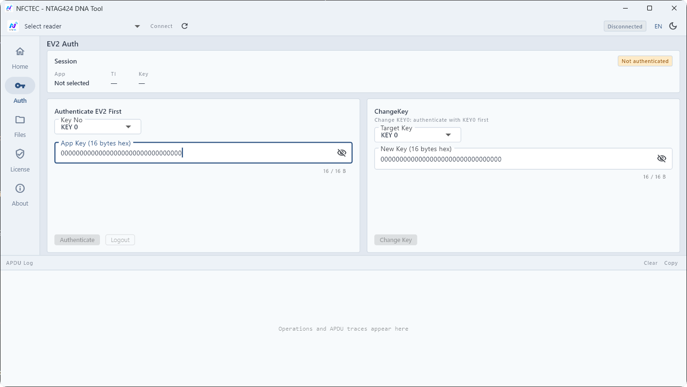
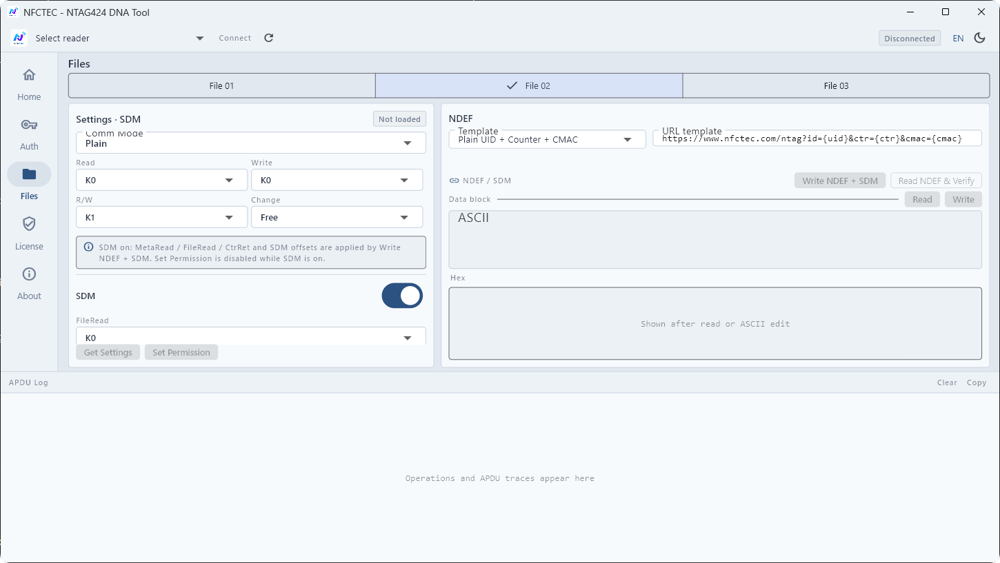

**[www.nfctec.com](https://www.nfctec.com)** — NFCTEC NFC & smart card software, hardware and cloud.

# NTAG424 DNA Personalization & Encoding Software

Windows and macOS tool for **NXP NTAG 424 DNA** / **NTAG 424 DNA Tag Tamper**: encode NDEF, configure **SDM / SUN** (Secure Dynamic Messaging / Secure Unique NFC), **EV2 / LRP** authenticate, **ChangeKey**, and set file permissions.

- Website: [https://www.nfctec.com](https://www.nfctec.com)
- **Download (Windows x64 & macOS):** [https://nfctec.com/en/downloads](https://nfctec.com/en/downloads)

NTAG424 DNA 发卡与编码软件：SDM/SUN 动态防伪链接、EV2 认证、改密钥、NDEF 写入。下载见 [nfctec.com/en/downloads](https://nfctec.com/en/downloads)。

## Download

| Platform | File | Link |
| --- | --- | --- |
| Windows x64 | NFCTEC NTAG424 DNA Tool | [Download Center](https://nfctec.com/en/downloads) |
| macOS | NTAG424Tool-macOS | [Download Center](https://nfctec.com/en/downloads) |

Works with PC/SC USB NFC readers (ACR122U, Identiv, HID Omnikey, Feitian, ACS, ISO 14443 Type A CCID) and Android NFC.

## Features

**Authentication & keys**  
AuthenticateEV2First / AuthenticateLRP with KEY 0–4 (AES-128). ChangeKey from factory `00…00`. Session shows App, TI and Key. Live APDU log for AN12196 / AN12304 style debugging.

**Files & access**  
Read/write File 01 / 02 / 03 (NFC Forum Type 4 / NDEF). GetFileSettings and ChangeFileSettings: Read, Write, ReadWrite, Change, FileRead; CommMode Plain, MAC or Full.

**SDM / SUN encoding**  
Enable Secure Dynamic Messaging and write a unique URL on every tap: UID, ReadCounter and CMAC (`PICCData`, EncPICCData, SDMMAC). Example:

`https://www.nfctec.com/ntag?id={uid}&ctr={ctr}&cmac={cmac}`

Supports SDMMetaRead, SDMFileRead, SDMEncFileData, ASCII mirroring. **Write NDEF + SDM** and **Read NDEF & Verify** for anti-counterfeit / brand-protection labels (wine, luxury, pharma, warranty cards) — replay and clone protection via the tap counter.

**NTAG 424 DNA TT**  
Same command set on Tag Tamper (open-detect) inlays.

Trial: read, get settings, NDEF verify, EV2 auth. Full license via email code.

## Screenshots

EV2 authentication and ChangeKey:

File permissions, SDM/SUN and NDEF URL:

## Related products

From [www.nfctec.com](https://www.nfctec.com): NTAG213 / 215 / 216, NTAG 424 DNA / DNA TT (NT4H2421Gx), MIFARE DESFire EV2/EV3, Ultralight EV1/C, JavaCard JCOP, desktop readers, and SUN verification cloud. Use NTAG424 when you need AES SDM instead of a static NDEF URL.

[Download Center](https://nfctec.com/en/downloads) also has JavaCard Tool and Issuance Workbench.

## About NFCTEC

[NFCTEC](https://www.nfctec.com) — NFC factory in Shenzhen: encoding software, USB/CCID readers, antennas, PVC / wet inlay / wristband, HSM-backed SDM/SUN verification.

[www.nfctec.com](https://www.nfctec.com) · [Downloads](https://nfctec.com/en/downloads)
