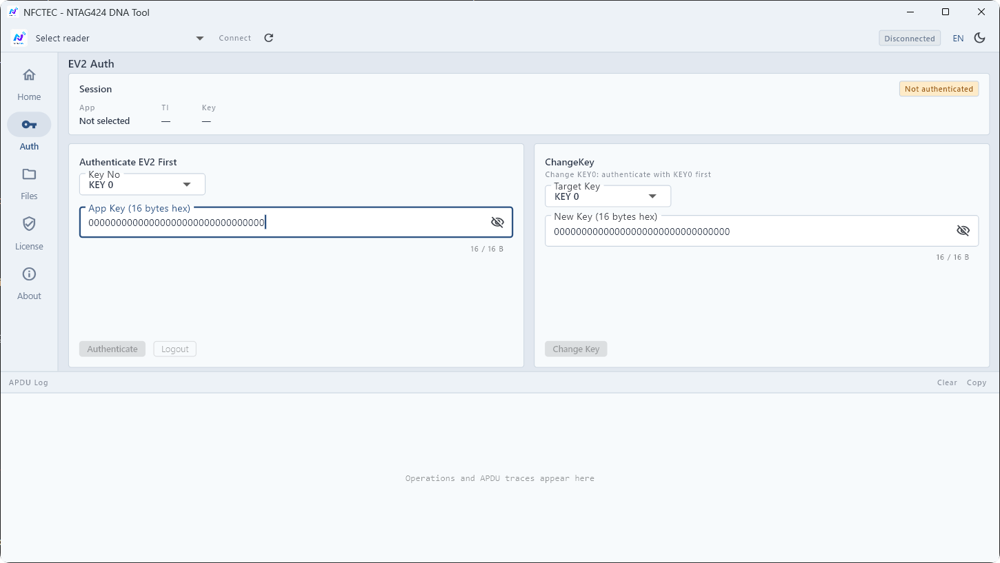
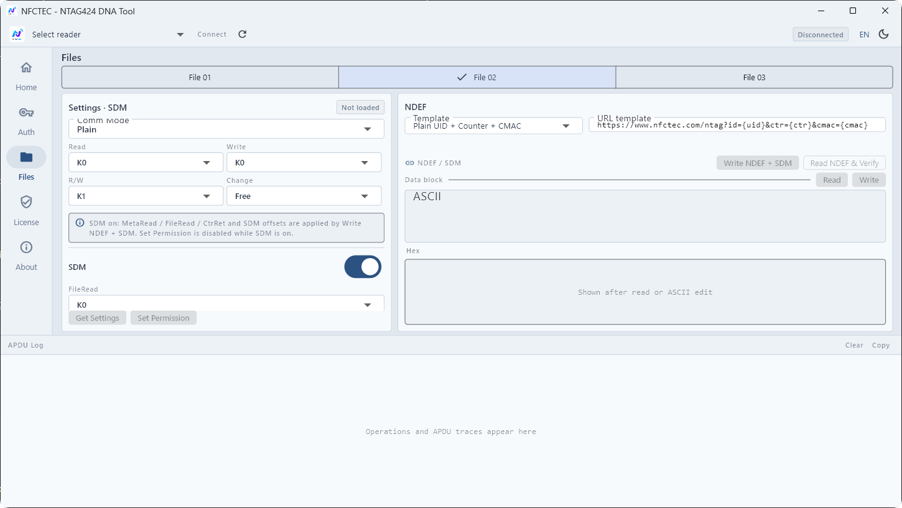

**[English](README.md)** · **[中文](README.zh-CN.md)**

**[www.nfctec.com](https://www.nfctec.com)** — NFCTEC NFC 与智能卡软件、硬件与云服务。

# NTAG424 DNA 发卡编码软件 — NFC 防伪标签

Windows / macOS 工具，用于 **NXP NTAG 424 DNA** / **NTAG 424 DNA Tag Tamper**：写入 NDEF、配置 **SDM / SUN**（动态防伪链接）、**EV2 / LRP** 认证、**改密钥**、设置文件权限。

- 官网：[https://www.nfctec.com](https://www.nfctec.com)
- **下载（Windows x64 与 macOS）：** [https://nfctec.com/en/downloads](https://nfctec.com/en/downloads)

把 SDM/SUN 动态验真链接写进标签，手机点一下打开唯一网址，用于酒类、奢侈品、药品、保修卡一物一码验真。

## 下载

| 平台 | 文件 | 链接 |
| --- | --- | --- |
| Windows x64 | NFCTEC NTAG424 DNA Tool | [下载中心](https://nfctec.com/en/downloads) |
| macOS | NTAG424Tool-macOS | [下载中心](https://nfctec.com/en/downloads) |

支持 PC/SC USB NFC 读卡器（ACR122U、Identiv、HID Omnikey、飞天、ACS 等 ISO 14443 Type A）以及 Android NFC。

## 功能

**认证与密钥**  
AuthenticateEV2First / AuthenticateLRP，KEY 0–4（AES-128）。出厂全 0 密钥可 ChangeKey。会话显示 App、TI、Key。APDU 日志便于对照 NXP AN12196 / AN12304。

**文件与权限**  
读写 File 01 / 02 / 03（NFC Forum Type 4 / NDEF）。GetFileSettings / ChangeFileSettings：读、写、读写、改权限、FileRead；通信模式 Plain / MAC / Full。

**SDM / SUN 编码**  
打开 Secure Dynamic Messaging，每次点触写入带 UID、计次器、CMAC 的唯一 URL。例如：

`https://www.nfctec.com/ntag?id={uid}&ctr={ctr}&cmac={cmac}`

支持 SDMMetaRead、SDMFileRead、SDMEncFileData、ASCII 镜像。**Write NDEF + SDM**、**Read NDEF & Verify**。

**NTAG 424 DNA TT**  
撕毁检测（Tag Tamper）标签使用同一套命令。

试用：读卡、读设置、NDEF 校验、EV2 认证。正式版邮箱激活。

## NFC 防伪 / SUN 验真

普通 NDEF 或二维码链接是固定的，复制标签就能假冒。**NTAG424 DNA NFC 防伪**使用 SUN/SDM：每次点触生成带 UID、计次器（ReadCounter）和 CMAC 的动态 URL，由 [www.nfctec.com](https://www.nfctec.com) 云端校验。克隆、重放旧链接会失败。需要开封检测时用 **NTAG 424 DNA Tag Tamper**。

适用：酒类防伪、奢侈品防伪标签、药品溯源、NFC 保修卡、品牌一物一码验真。编码用本工具，验真走官网云端。

## 截图

EV2 认证与改密钥：

文件权限、SDM/SUN 与 NDEF 网址：

## 相关产品

[www.nfctec.com](https://www.nfctec.com)：NTAG213 / 215 / 216、NTAG 424 DNA / DNA TT（NT4H2421Gx）、MIFARE DESFire EV2/EV3、Ultralight EV1/C、JavaCard JCOP、桌面读卡器、SUN 验真云。需要 AES 动态防伪而不是固定 NDEF 时用 NTAG424。

[下载中心](https://nfctec.com/en/downloads) 另有 JavaCard 工具与发卡工作台。

## 关于 NFCTEC

[NFCTEC](https://www.nfctec.com) — 深圳 NFC 工厂：编码软件、USB/CCID 读卡器、天线、PVC / 湿 inlay / 腕带、HSM 保护的 SDM/SUN 验真。

[www.nfctec.com](https://www.nfctec.com) · [下载](https://nfctec.com/en/downloads)
